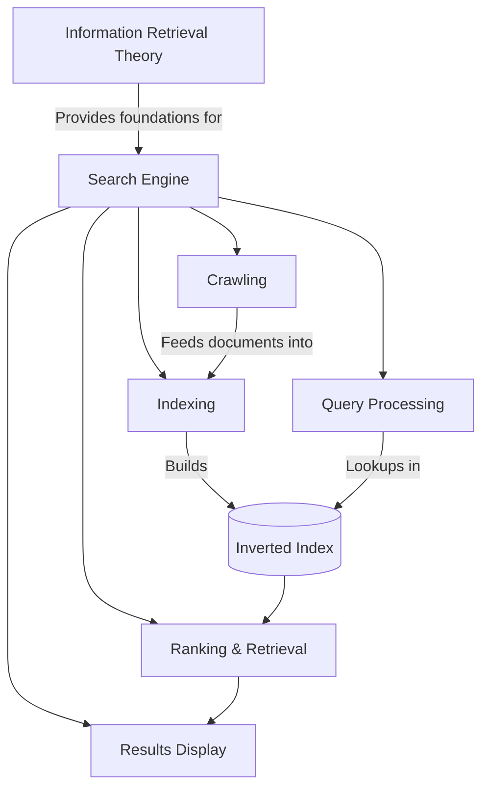
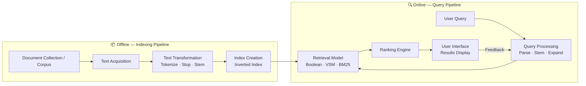

# Module 1.1 — Introduction to Information Retrieval

> **Syllabus Coverage:** Introduction to IR · Relationship between IR and Search Engines · The Impact of the Web on IR

---

## 1. What is Information Retrieval (IR)?

**Information Retrieval (IR)** is the science of representing, storing, organizing, and providing access to *information items* so that users can efficiently locate content relevant to their needs.

- **Information items** include: documents, web pages, online catalogs, structured records, multimedia objects.
- **Early IR goals:** Text indexing and searching for useful documents within a collection.
- **Modern IR scope** has expanded to: modelling, web search, text classification, system architecture, user interfaces, data visualization, filtering, and multilingual retrieval.

### IR vs. Data Retrieval — A Critical Distinction

| Dimension | Data Retrieval | Information Retrieval |
|---|---|---|
| **Example System** | Relational Database (SQL) | Search Engine, Digital Library |
| **Data Structure** | Well-defined, rigid schema | Unstructured / semi-structured text |
| **Query Type** | Exact-match queries | Keyword / natural language queries |
| **Match Semantics** | Exact | Approximate / relevance-ranked |
| **Tolerance for Error** | Zero — one wrong result = failure | Partial — ranked output acceptable |
| **Output** | Exact record set | Ranked list of relevant documents |

> **Key exam point:** Data retrieval finds *what matches*; IR finds *what is relevant*. Relevance is approximate and subjective — this is IR's central challenge.

---

## 2. The IR Problem

### 2.1 Information Need → Query Translation

Users rarely express their full information need directly as a system query. The process is:

```
Information Need (complex, natural language)
         ↓  [Translation / Abstraction]
Query (set of keywords / index terms)
         ↓  [Submitted to IR System]
Ranked List of Relevant Documents
```

**Example:**  
- *Information Need:* "Find all documents addressing the role of the Federal Government in financing AMTRAK."  
- *Query submitted:* `federal government AMTRAK financing`

### 2.2 The Central Goal of IR

> **Retrieve all items relevant to a user query, while retrieving as few non-relevant items as possible.**

- The IR system must **rank** information items by *degree of relevance* — not just find them.
- **Relevance** is the central concept in IR — it is dynamic, subjective, and context-dependent.

### 2.3 User Task Taxonomy

| User Behavior | Characteristics | Example |
|---|---|---|
| **Searching / Querying** | Well-defined need; translates to specific keywords | "What is the capital of France?" |
| **Browsing / Navigating** | Poorly-defined or broad interest; exploratory | Browsing Formula 1 and IndyCar documents |

---

## 3. Relationship between IR and Search Engines

Search engines are the most prominent **application** of IR technology. The relationship is:

- IR provides the **theoretical foundations** (models, indexing, ranking).
- Search engines are **large-scale deployments** of IR systems on web-scale data.



### Core Relationship Points

- **Libraries** were the first IR systems — card catalogs were early manual indexes.
- The **Web's arrival** transformed IR from a niche academic discipline into mainstream technology overnight.
- A web search engine is an IR system operating at planetary scale, with additional challenges introduced by the web (see Section 5).

---

## 4. Architecture of the IR System

### 4.1 High-Level Software Architecture

An IR system has two primary pipelines: **Indexing** (offline, document-side) and **Retrieval** (online, query-side).



### 4.2 Component Descriptions

| Component | Role |
|---|---|
| **Text Acquisition** | Crawling / collecting raw documents from sources |
| **Text Transformation** | Tokenizing, stopping, stemming, phrase extraction |
| **Index Creation** | Building the Inverted Index mapping terms → document IDs |
| **Query Processor** | Parses and normalizes user query; may expand it |
| **Retrieval Model** | Applies a relevance model (e.g., VSM, BM25) using the index |
| **Ranking Engine** | Sorts retrieved documents by relevance score |
| **User Interface** | Displays results; captures user feedback for refinement |

### 4.3 The Retrieval Process (Step-by-Step)

1. User expresses an **information need** → formulates a **query**.
2. **Query Processor** tokenizes, removes stopwords, and stems the query terms.
3. Processed query terms are looked up in the **Inverted Index**.
4. **Retrieval Model** computes a relevance score for each candidate document.
5. **Ranking Engine** sorts documents by descending relevance score.
6. **Top-k results** are displayed to the user.
7. User **feedback** (clicks, reformulations) refines the process iteratively.

---

## 5. The Impact of the Web on IR

The Web is the single biggest transformational force in IR history. There are **5 major impacts**:

### Impact 1 — Distributed Document Collection → Crawling

- Web pages are distributed across millions of sites and connected via **hyperlinks**.
- IR systems must now **crawl** the web: collect pages and store local copies *before* indexing.
- **Crawling** is a new phase not present in traditional IR systems.

### Impact 2 — Scale and Performance Demands

- The web's collection size and daily query volume are enormous.
- **Performance** and **scalability** have become critical design requirements.
- Traditional IR systems were not designed for billions of documents and millions of queries/second.

### Impact 3 — Relevance Prediction is Harder

- In very large, heterogeneous collections, predicting relevance is much harder.
- **New evidence sources** unique to the web help: **hyperlinks** (link structure, PageRank) and **user click data**.

### Impact 4 — Extended User Needs (Transactional & Navigational)

- The Web is a commercial medium; users have needs beyond informational queries.
- Search has expanded to include **transactional** needs (buying a book, downloading software) and **navigational** needs (finding a specific website).

### Impact 5 — Web Spam / Adversarial IR

- **Web spam:** Abusive injection of commercial content disguised as informational content.
- This is so significant it has spawned its own field: **Adversarial Web Retrieval**.
- Search engines must detect and demote spammy pages.

### Summary Table

| Impact | Challenge Introduced |
|---|---|
| Distributed collection | Requires crawling before indexing |
| Massive scale | Performance & scalability become critical |
| Relevance harder to predict | Must exploit hyperlinks & click signals |
| Commercial medium | User needs beyond pure text retrieval |
| Web spam | Adversarial manipulation of rankings |

---

## 6. Practical Issues Introduced by the Web

Beyond the five core impacts, the Web introduces several practical complications for IR systems:

- **Security:** Commercial transactions over the Internet are not fully secure; authentication and data integrity are concerns.
- **Privacy:** Users exchange personal data; IR systems must balance personalization with privacy.
- **Copyright & Patent Rights:** Wide-spread data on the Web complicates intellectual property law across jurisdictions.
- **Multilingual Retrieval / OCR:** Documents exist in many languages and formats (scanned PDFs, images), requiring cross-language IR and OCR pipelines.

---

## 7. Quick-Reference: Key Definitions

| Term | Definition |
|---|---|
| **Information Retrieval (IR)** | Representation, storage, organization of, and access to information items |
| **Index Terms** | Keywords that summarize a user's information need; extracted from a query |
| **Relevance** | Degree to which a retrieved item satisfies the user's information need |
| **Inverted Index** | Data structure mapping terms → list of document IDs containing that term |
| **Crawling** | Automatic collection of web pages and storage in a central repository |
| **Web Spam** | Commercial content disguised as informational content to manipulate rankings |
| **Adversarial Web Retrieval** | Sub-field of IR focused on detecting and countering web spam |
| **Searching** | User behavior with a well-defined information need; submits keyword queries |
| **Browsing** | User behavior with a broad/poorly-defined need; navigates document collections |

---

## 8. Exam-Focused Summary

- **IR ≠ Data Retrieval:** IR deals with approximate relevance over unstructured text; data retrieval requires exact matches on structured data.
- **Relevance is central to IR** — ranked retrieval is the solution to the IR problem.
- **The Web transformed IR** by introducing crawling, scalability demands, link-based evidence, transactional needs, and spam.
- **Two pipelines:** Offline indexing (document-side) and online retrieval (query-side).
- **5 Web impacts** must be memorized: (1) Crawling, (2) Scale/Performance, (3) Relevance harder + new signals, (4) Transactional needs, (5) Web spam.

---

*Sources: Baeza-Yates & Ribeiro-Neto, Modern Information Retrieval (2nd Ed.) — Chapter 1; Basic Building Blocks IR notes; IR System SW Architecture notes.*
