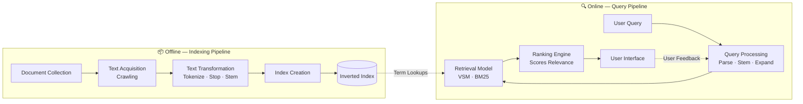
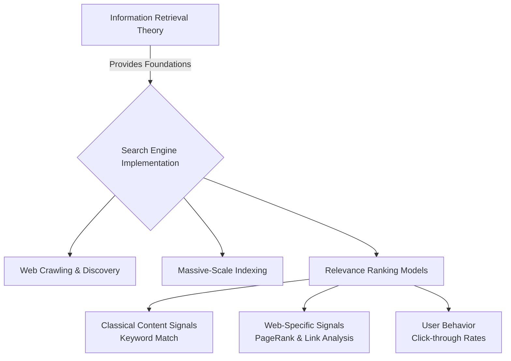

# Module 1.1 — Fundamentals of Information Retrieval

> **Syllabus Coverage:** Introduction to IR · Core Objectives · IR vs DBMS · Architecture of IR Systems · Relationship between IR and Search Engines · The Impact of the Web on IR

---

## 1. What is Information Retrieval (IR)?

**Information Retrieval (IR)** is the science of representing, storing, organizing, and providing access to *information items* (documents, web pages, multimedia) so users can efficiently locate content relevant to their needs. It acts as a bridge between information generators and users.

### 1.1 Core Objectives & The IR Problem
- **Primary Goal:** Retrieve all items relevant to a user query, while retrieving as few non-relevant items as possible. 
- **Success Measure (User Overhead):** Minimizing the time spent generating queries, executing searches, and scanning results (excluding the time spent actually reading the relevant data).
- **The Central Challenge:** Relevance is approximate, dynamic, subjective, and context-dependent.

### 1.2 Information Need → Query Translation
Users rarely express their full information need directly. The fundamental IR problem lies in translation:
1. **Information Need:** Complex, natural language concept in the user's mind *(e.g., "Find documents on the government financing AMTRAK.")*
2. **Translation:** Abstracting the need into a system-friendly format.
3. **Query:** The actual keywords submitted *(e.g., `federal government AMTRAK financing`)*.

---

## 2. IR vs. Data Retrieval (DBMS)

While a Database Management System (DBMS) focuses on exact matches within structured data, IR deals with the complexities of unstructured or semi-structured information.

| Dimension | Data Retrieval (DBMS) | Information Retrieval (IR) |
| :--- | :--- | :--- |
| **Data Nature** | Structured (Tables, Records, rigid schema) | Unstructured / semi-structured text |
| **Query Type** | Formal (e.g., SQL), Exact-match | Natural language, Keyword queries |
| **Match Semantics** | Exact match based on values | Partial / Best match (Ranked by relevance) |
| **Model Type** | Deterministic | Probabilistic |
| **Inference** | Deduction | Induction |
| **Error Tolerance** | Zero (one wrong result = total failure) | Partial (degrees of relevance are acceptable) |

---

## 3. Architecture of the IR System

An IR system operates via two primary pipelines: **Indexing** (offline preparation) and **Retrieval** (online execution).

### The Retrieval Process (Step-by-Step)
1. **Text Acquisition:** System crawls and collects raw documents.
2. **Text Transformation:** Text is normalized (tokenized, stopwords removed, stemmed).
3. **Index Creation:** System builds the **Inverted Index** (mapping terms to document IDs).
4. **Query Processing:** User submits a query; the system parses and stems the query terms.
5. **Retrieval Model:** Query terms are looked up in the Inverted Index to compute candidate scores.
6. **Ranking Engine:** Documents are sorted by descending relevance score.
7. **Display & Feedback:** Top-k results are shown; user clicks provide feedback for future refinement.

---

## 4. Relationship Between IR and Search Engines

Search engines are the most prominent, large-scale application of IR technology. **IR provides the theoretical framework, while Search Engines represent the practical, planetary-scale implementation.**

---

## 5. The Impact of the Web on IR

The Web transformed IR from a niche academic discipline (curated libraries) into a dynamic, massive-scale repository of human knowledge. This introduced **5 major impacts**:

1. **Distributed Collection (Crawling):** Data is not centralized. Systems must automatically *crawl* the web via hyperlinks before indexing.
2. **Massive Scale & Performance:** Systems shifted from megabytes to petabytes. Handling billions of daily queries with sub-second latency is a critical engineering requirement.
3. **Relevance Prediction is Harder:** In heterogeneous collections, classical keyword matching fails. Engines must exploit **Link Analysis** (PageRank) and user behavior.
4. **Extended User Needs:** Users now have **transactional** needs (buying, downloading) and **navigational** needs (finding a specific URL), alongside traditional informational queries.
5. **Web Spam:** The commercial nature of the web birthed **Adversarial Web Retrieval**, forcing engines to detect and demote malicious content (keyword stuffing, link farming).

### 5.1 Web-Centric Challenges Taxonomy

The difficulties of web search can be categorized into two distinct buckets:

| Category | Specific Challenges |
| :--- | :--- |
| **Data-Centric** | **Distributed Nature:** Millions of servers with varying reliability. **Volatility:** 50% of the web changes within months (broken links). **Redundancy:** ~30% of web pages are duplicates. **Spam/Quality:** Zero editorial oversight leads to malicious data. |
| **Interaction-Centric** | **Query Ambiguity:** Users submit very short (1–3 word) queries. **Information Overload:** Systems must summarize thousands of matches into digestible snippets. |

### 5.2 Comparative Summary: Classical vs. Web IR

| Feature | Classical IR | Web IR |
| :--- | :--- | :--- |
| **Volume** | Large (curated) | Huge (unbounded, planetary-scale) |
| **Data Quality** | Clean, minimal duplicates | Highly noisy, ~30% duplication |
| **Volatility** | Infrequent changes | Constant flux (highly dynamic) |
| **Diversity** | Homogeneous (mostly text) | Highly diverse (HTML, media, scripts, PDFs) |
| **Retrieval Basis** | Content-based | Content-based + Link-based + User Signals |

---

## 6. Quick-Reference Glossary

- **Inverted Index:** The core data structure mapping index terms to a list of document IDs containing that term.
- **Relevance:** The subjective degree to which a retrieved item satisfies the user's actual information need.
- **Crawling:** The automated discovery, collection, and local storage of web pages for indexing.
- **Web Spam:** Abusive injection of commercial/malicious content disguised as informational to manipulate search rankings.
- **Searching vs. Browsing:** Searching occurs when a user has a well-defined need and submits keywords. Browsing is exploratory navigation with a broad or poorly-defined need.

---

## 🎯 Exam-Focused Summary
1. **IR vs DBMS:** IR ranks unstructured text based on probabilistic relevance; DBMS strictly matches structured data. 
2. **The Goal of IR:** Retrieve the maximum number of relevant documents while minimizing non-relevant ones and user overhead.
3. **The Web Paradigm Shift:** You must be able to list the 5 impacts: (1) Crawling requirement, (2) Planetary scale, (3) Link-based relevance, (4) Transactional user intent, (5) Web Spam.
4. **System Architecture:** Memorize the split between the **Offline Pipeline** (Acquisition -> Transformation -> Indexing) and the **Online Pipeline** (Query Parsing -> Retrieval Model -> Ranking).