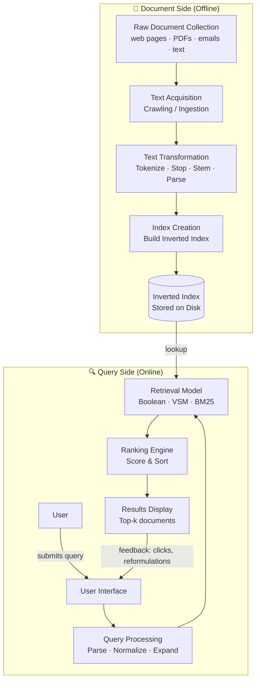
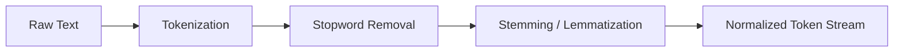
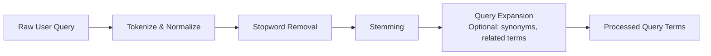
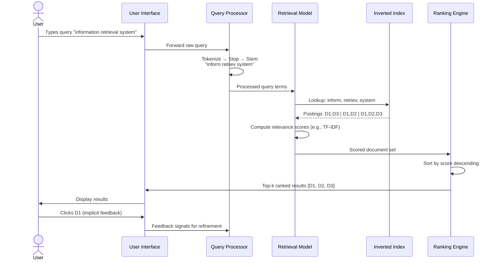

# Module 1.2 — IR Systems: Software Architecture & The Retrieval Process

> **Syllabus Coverage:** Software Architecture of the IR System · The Retrieval Process

---

## 1. Overview — What Does an IR System Do?

An IR system accepts a **user query**, searches a **document collection**, and returns a **ranked list of relevant documents**. Internally, this decomposes into two clearly separated pipelines:

| Pipeline | Trigger | Speed | Purpose |
|---|---|---|---|
| **Indexing Pipeline** | Offline / batch | Slow (pre-computed) | Build searchable data structures from documents |
| **Retrieval Pipeline** | Online / per-query | Fast (real-time) | Answer user queries using the index |

> **Critical exam point:** Indexing is done *before* any query arrives. When a user searches, the system never reads raw documents — it reads the pre-built index.

---

## 2. High-Level Software Architecture



---

## 3. Document-Side Architecture (Indexing Pipeline)

### 3.1 Document Collection / Corpus

- The **corpus** is the universe of all documents the IR system can retrieve from.
- Sources: web pages (via crawlers), PDFs, emails, database records, enterprise documents.
- In web-scale systems, **crawlers** continuously harvest new pages and update the corpus.

### 3.2 Text Acquisition

- **Crawling** (web context): Automated bots follow hyperlinks and download page content.
- **Direct ingestion** (enterprise context): Documents are pushed into the system via APIs or file uploads.
- Output: Raw document bytes + metadata (URL, timestamp, language).

> See Module 1.1 for why crawling is a new phase introduced by the Web.

### 3.3 Text Transformation

This stage converts raw text into normalized, indexable tokens. It is applied to **both documents and queries** (symmetry is mandatory — both must be processed identically).

#### Sub-steps of Text Transformation:



| Sub-step | What it does | Example |
|---|---|---|
| **Tokenization** | Splits text into individual tokens (words) | `"IR systems work"` → `["IR", "systems", "work"]` |
| **Stopword Removal** | Removes high-frequency, low-information words | `["the", "is", "a", "of"]` → removed |
| **Stemming** | Reduces words to their root form (heuristic) | `"running"`, `"runs"` → `"run"` |
| **Lemmatization** | Reduces to dictionary base form (linguistically accurate) | `"better"` → `"good"` |
| **Phrase Detection** | Identifies multi-word units | `"New York"` treated as one token |

> **Stemming vs. Lemmatization:** Stemming is faster and cruder (Porter Stemmer); Lemmatization is slower but linguistically correct. Most IR systems use stemming for performance.

### 3.4 Index Creation — The Inverted Index

The **Inverted Index** is the primary data structure of all IR systems. It maps each unique term to the list of documents containing it.

#### Structure:

```
Term          →  Postings List (doc IDs [+ positions + frequencies])
─────────────────────────────────────────────────────────────────
"retrieval"   →  [Doc1(tf=3), Doc4(tf=1), Doc7(tf=5)]
"information" →  [Doc1(tf=2), Doc2(tf=4), Doc4(tf=1)]
"system"      →  [Doc2(tf=1), Doc3(tf=6), Doc7(tf=2)]
```

#### Inverted Index — Worked Example:

**Document Collection:**

| Doc ID | Content |
|---|---|
| D1 | "information retrieval system" |
| D2 | "retrieval model for system" |
| D3 | "information system design" |

**Inverted Index (after tokenization + stopping + stemming):**

| Term | Postings |
|---|---|
| `inform` | D1, D3 |
| `retriev` | D1, D2 |
| `system` | D1, D2, D3 |
| `model` | D2 |
| `design` | D3 |

**Query:** `"information retrieval"`  
→ Lookup `inform` → {D1, D3}, lookup `retriev` → {D1, D2}  
→ Intersection (AND): **{D1}** ← most relevant document

#### Why Inverted Index?

- Without it: every query requires scanning every document (O(N) per query — too slow).
- With it: query lookups are O(1) per term + postings list merge — extremely fast.

#### Extended Inverted Index (with positions):

```
"retrieval" → [D1: positions(3,15), D2: positions(1)]
```
Position data enables **phrase queries** and **proximity ranking** (words near each other score higher).

---

## 4. Query-Side Architecture (Retrieval Pipeline)

### 4.1 User Interface (UI)

The front-end through which the user interacts with the IR system.

**Responsibilities:**
- Accept free-text or structured queries.
- Display ranked results (title, snippet, URL).
- Support **relevance feedback** (explicit: thumbs up/down; implicit: clicks, dwell time).
- Offer features like query suggestions ("Did you mean…?"), filters, and facets.

**Interaction Models:**

| Model | Description | Example |
|---|---|---|
| **Pull** | User explicitly requests information | Typing a search query |
| **Push** | System proactively delivers information | News alerts, recommendations |

### 4.2 Query Processing

The query undergoes the **same transformation pipeline** as documents (tokenization → stopping → stemming), plus additional steps:



- **Query Expansion:** Adds synonyms or related terms to improve recall. e.g., query `"car"` expanded to `"car OR automobile OR vehicle"`.
- **Query Reformulation:** User-driven refinement based on initial results.

### 4.3 Retrieval Model

The retrieval model defines the mathematical framework for computing **relevance scores** between a query and each document. It uses the inverted index to find candidate documents.

| Model | Mechanism | Output |
|---|---|---|
| **Boolean Model** | Exact logical matching (AND, OR, NOT) | Binary: relevant or not |
| **Vector Space Model (VSM)** | Represents docs and queries as TF-IDF vectors; cosine similarity | Continuous score ∈ [0,1] |
| **Probabilistic Model (BM25)** | Probability that a document is relevant given the query | Ranked score |

> Retrieval Models are covered in depth in **Module 2**.

### 4.4 Ranking Engine

Takes the set of candidate documents from the retrieval model and **sorts them by descending relevance score**.

**Factors used in ranking:**

- **Query features:** Query length, query term specificity.
- **Document features:** Document length, PageRank / authority score, recency.
- **Query-document interaction features:** Term frequency in document (TF), inverse document frequency (IDF), term proximity.

**Key weighting scheme: TF-IDF**

| Factor | Formula | Intuition |
|---|---|---|
| **TF** (Term Frequency) | `tf(t,d) = count of t in d` | More occurrences → more relevant |
| **IDF** (Inverse Doc Freq) | `idf(t) = log(N / df(t))` | Rarer terms → more discriminating |
| **TF-IDF** | `tf-idf = tf × idf` | High score = term is frequent in doc but rare across corpus |

### 4.5 Output & Feedback Loop

- Top-k results are displayed to the user as **snippets** (title + short excerpt + URL).
- **Explicit feedback:** User marks results as relevant/irrelevant.
- **Implicit feedback:** Click-through rates, dwell time, query reformulations.
- Feedback is used for **query reformulation** (Rocchio algorithm — Module 3.2) and to improve future rankings via machine learning.

---

## 5. The Retrieval Process — End-to-End Flow



---

## 6. Architectural Comparison — Traditional vs. Web IR System

| Dimension | Traditional IR System | Web Search Engine |
|---|---|---|
| **Collection** | Static, curated corpus | Dynamic, distributed web |
| **Acquisition** | Manual ingestion | Automated crawling |
| **Scale** | Thousands of docs | Billions of pages |
| **Index updates** | Periodic batch updates | Near real-time continuous updates |
| **Ranking signals** | TF-IDF only | TF-IDF + PageRank + click data + hundreds more |
| **Spam** | Not a concern | Major adversarial problem |
| **Latency requirement** | Seconds acceptable | Sub-second mandatory |

---

## 7. Quick-Reference: Key Definitions

| Term | Definition |
|---|---|
| **Indexing Pipeline** | Offline processing of documents to build the inverted index |
| **Retrieval Pipeline** | Online processing of queries to return ranked results |
| **Inverted Index** | Data structure mapping terms → list of documents containing them |
| **Postings List** | The list of document IDs (and optionally positions/frequencies) for a term |
| **Tokenization** | Splitting raw text into individual word tokens |
| **Stopwords** | Common words with low information value, removed during processing |
| **Stemming** | Heuristic reduction of words to their root form |
| **TF-IDF** | Term Frequency × Inverse Document Frequency; standard term-weighting scheme |
| **Query Expansion** | Adding synonyms/related terms to a query to improve recall |
| **Relevance Feedback** | Using user signals (clicks, ratings) to refine retrieval |
| **Pull Technology** | User explicitly initiates information request |
| **Push Technology** | System proactively delivers information to user |

---

## 8. Exam-Focused Summary

- **Two pipelines:** Offline indexing (document-side) builds the index; online retrieval (query-side) answers queries.
- **Inverted index** is the critical data structure — maps term → postings list of doc IDs.
- **Text transformation is symmetric** — identical preprocessing must be applied to both documents and queries.
- **Retrieval ≠ Ranking:** Retrieval finds a candidate set; ranking orders them by relevance score.
- **TF-IDF** is the baseline weighting scheme — high score means term is frequent in the document but rare globally.
- **Feedback loop** is essential — user clicks and reformulations feed back into the system to improve future results.
- **Web IR systems** differ from traditional ones primarily in scale, crawling, continuous index updates, and multi-signal ranking.

---

*Sources: Baeza-Yates & Ribeiro-Neto, Modern Information Retrieval (2nd Ed.) — Chapter 1; IR System SW Architecture notes; Basic Building Blocks IR notes.*
