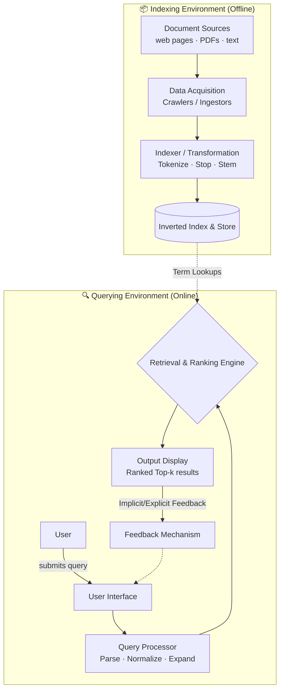
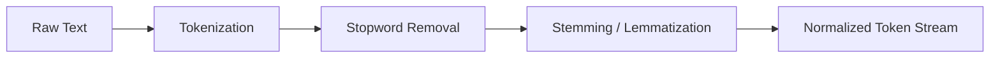
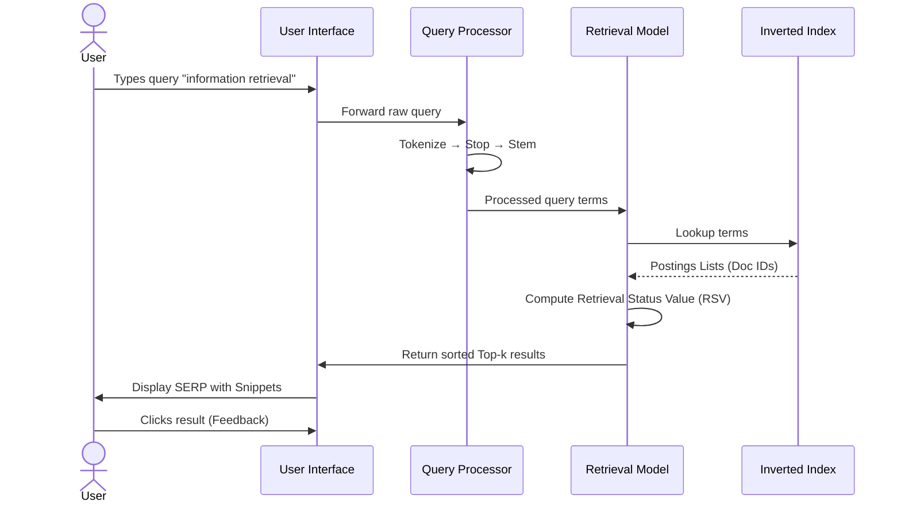

# Module 1.2 — IR Systems: Software Architecture & The Retrieval Process

> **Syllabus Coverage:** Software Architecture of the IR System · The Retrieval Process

---

## 1. Overview — What Does an IR System Do?

An IR system accepts a **user query**, searches a **document collection**, and returns a **ranked list of relevant documents**. Internally, this decomposes into two clearly separated pipelines:

| Pipeline | Trigger | Speed | Purpose |
| :--- | :--- | :--- | :--- |
| **Indexing Pipeline** | Offline / batch | Slow (pre-computed) | Build searchable data structures from documents |
| **Retrieval Pipeline** | Online / per-query | Fast (real-time) | Answer user queries using the index |

> **Critical exam point:** Indexing is done *before* any query arrives. When a user searches, the system never reads raw documents — it reads the pre-built index.

---

## 2. High-Level Software Architecture

A modern IR system architecture is designed to manage massive document collections while providing near-instantaneous responses to user queries.

### 2.1 Architectural Layers

| Layer | Component | Function |
| :--- | :--- | :--- |
| **Data Acquisition** | Web Crawler / Ingestor | Collects raw data from distributed sources and builds the document corpus. |
| **Transformation** | Indexer | Preprocesses text (tokenization, stop-word removal, stemming) to build an Inverted Index. |
| **Interaction** | User Interface (UI) | Bridges the user and system; accepts queries and displays ranked results. |
| **Search Engine** | Query Processor | Translates the raw user query into a system-ready format for matching. |
| **Decision Logic** | Retrieval & Ranking Engine | Uses IR models (e.g., BM25) to score documents and sort them by relevance. |
| **Improvement** | Feedback Mechanism | Captures user interactions (clicks, dwell time) to refine future search quality. |

### 2.2 System-Level Software Architecture Diagram



---

## 3. Document-Side Architecture (Indexing Pipeline)

### 3.1 Document Collection / Corpus
- The **corpus** is the universe of all documents the IR system can retrieve from.
- Sources: web pages (via crawlers), PDFs, emails, database records.
- In web-scale systems, **crawlers** continuously harvest new pages and update the corpus.

### 3.2 Text Transformation
This stage converts raw text into normalized, indexable tokens. It is applied to **both documents and queries** (symmetry is mandatory — both must be processed identically).



| Sub-step | What it does | Example |
| :--- | :--- | :--- |
| **Tokenization** | Splits text into individual tokens (words) | `"IR systems work"` → `["IR", "systems", "work"]` |
| **Stopword Removal** | Removes high-frequency, low-information words | `["the", "is", "a", "of"]` → removed |
| **Stemming** | Reduces words to their root form (heuristic) | `"running"`, `"runs"` → `"run"` |
| **Lemmatization** | Reduces to dictionary base form (linguistically accurate) | `"better"` → `"good"` |

> **Exam Note:** Stemming is faster and cruder (e.g., Porter Stemmer); Lemmatization is slower but linguistically correct.

### 3.3 Index Creation — The Inverted Index
The **Inverted Index** is the primary data structure of all IR systems. It maps each unique term to the list of documents containing it.

**Structure Example:**
```text
Term          →  Postings List (doc IDs [+ positions + frequencies])
─────────────────────────────────────────────────────────────────
"retrieval"   →  [Doc1(tf=3), Doc4(tf=1), Doc7(tf=5)]
"system"      →  [Doc2(tf=1), Doc3(tf=6), Doc7(tf=2)]
```
*Why use it?* It drops query search time from O(N) (scanning every document) to O(1) per term (instant lookup).

---

## 4. The Retrieval Process — End-to-End Flow

The retrieval process is a systematic sequence of steps that transforms a vague human "information need" into a set of retrieved objects.

### 4.1 The Lifecycle of a Search

1. **Identification of Information Need:** The user recognizes a knowledge gap.
2. **Query Formulation:** The user translates the internal need into a formal search string (often short and ambiguous).
3. **Query Processing:** The system parses the query, applying the exact same normalization used in indexing. Systems may apply **Query Expansion** (adding synonyms) to improve recall.
4. **Document Matching:** The system uses a Retrieval Model (e.g., Vector Space) to find candidate documents via the Inverted Index.
5. **Relevance Ranking:** Each matching document is assigned a **Retrieval Status Value (RSV)**. Documents are sorted descending by this score.
6. **Presentation:** The system displays the **Search Engine Results Page (SERP)**, utilizing **Query-Biased Summaries (Snippets)** to help users judge relevance.
7. **Feedback & Iteration (Berry-picking):** Users evaluate results and iteratively refine their query as their information need evolves.

### 4.2 Functional Flow (System vs. User)

| Stage | User Side Activity | System Side Activity |
| :--- | :--- | :--- |
| **Input** | Defines Problem & Formulates Query | Accepts Query through UI |
| **Analysis** | Selects keywords/terms | Normalizes and parses Query |
| **Execution** | Waits for response | Matches Query terms with Index |
| **Output** | Scans results & judges Relevance | Ranks and Displays query-biased snippets |
| **Refinement** | Reformulates Query (Berry-picking) | Adjusts based on Relevance Feedback |



---

## 5. Critical Technical Concepts in 1.2

- **Retrieval Status Value (RSV):** The numeric score assigned to a document by a ranking algorithm indicating its predicted level of relevance to the query.
- **Iterative Search (Berry-picking):** The concept that search is a dynamic, evolving process where user needs change as they encounter new information.
- **Query-Biased Summaries (Snippets):** Short excerpts of document text shown in results that highlight query terms to help users judge relevance without opening the full document.
- **Adversarial Web Retrieval:** The architectural necessity of spam detection and SEO filtering to prevent low-quality documents from dominating top ranks.
- **TF-IDF:** The baseline weighting scheme used in ranking. A high score means a term is frequent in the specific document (TF) but rare across the entire corpus (IDF).

---

## 🎯 Exam-Focused Summary

- **Two pipelines:** Offline indexing (document-side) builds the index; online retrieval (query-side) answers queries.
- **Inverted index** is the critical data structure — maps terms to a postings list of document IDs.
- **Text transformation is symmetric:** Identical preprocessing (tokenize, stop, stem) must be applied to *both* documents and queries.
- **Retrieval ≠ Ranking:** Retrieval finds a candidate set via the index; ranking orders them by computing an RSV (Retrieval Status Value).
- **The Search Lifecycle:** Understand the flow from Information Need → Query → Processing → Matching → Ranking → Presentation (Snippets) → Iteration (Berry-picking).