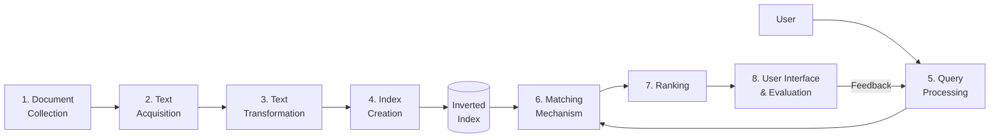
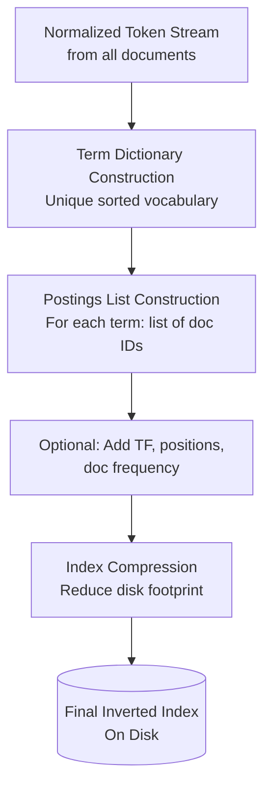

# Module 1.3 — Basic Building Blocks of an IR System

> **Syllabus Coverage:** The Indexing Process · The Query Process · Text Acquisition · Text Transformation · Index Creation · User Interaction · Ranking · Evaluation · Inverted Index

---

## 0. The Eight Building Blocks — At a Glance



Each block is a distinct, examinable component. The top row is the **offline indexing pipeline**; the bottom row is the **online query pipeline**.

---

## 1. Document Collection (Corpus)

- The **corpus** is the complete set of documents the IR system operates over.
- Can include: text files, web pages, PDFs, emails, structured records, multimedia metadata.
- Acts as the **primary information source** — the system can only return what it has indexed.
- In web IR, the corpus is dynamic (pages are added/removed constantly); in enterprise IR, it is typically static or slowly changing.

> **Exam note:** The quality and coverage of the corpus directly bounds the quality of retrieval — a document not in the corpus *cannot* be retrieved.

---

## 2. Text Acquisition

**Definition:** The process of obtaining raw document content and bringing it into the IR system for processing.

### Methods

| Method | Context | Description |
|---|---|---|
| **Crawling** | Web IR | Automated bots follow hyperlinks, download pages |
| **Direct ingestion** | Enterprise IR | Files pushed via API, file system, or upload |
| **Feed / syndication** | News, blogs | Real-time streams (RSS, APIs) |
| **OCR** | Scanned documents | Optical Character Recognition to extract text from images |

### What is produced?
- Raw document bytes + metadata (source URL, timestamp, language, MIME type).
- Documents are queued for the text transformation stage.

---

## 3. Text Transformation (Preprocessing)

**Definition:** Converting raw text into clean, normalized, indexable tokens. This stage is applied **identically to both documents and queries** — symmetry is mandatory.


### Sub-steps in Detail

#### 3.1 Tokenization
- Splits a stream of characters into individual units called **tokens** (usually words).
- Must handle: hyphenated words, apostrophes, numbers, URLs.

| Input | Tokens |
|---|---|
| `"IR systems work well"` | `[IR, systems, work, well]` |
| `"state-of-the-art"` | `[state, of, the, art]` or `[state-of-the-art]` — system-dependent |

#### 3.2 Normalization
- Convert all tokens to **lowercase**: `"Information"` → `"information"`.
- Remove punctuation, special characters.
- Expand abbreviations where applicable.

#### 3.3 Stopword Removal
- **Stopwords** are high-frequency, low-information words that add noise without discriminating power.
- Examples: `the`, `is`, `a`, `of`, `and`, `in`, `to`.
- Removing them reduces index size and speeds retrieval.
- **Trade-off:** Phrase queries like `"to be or not to be"` become impossible after stop-word removal → modern systems handle this with positional indexes.

#### 3.4 Stemming vs. Lemmatization

| Feature | Stemming | Lemmatization |
|---|---|---|
| **Method** | Heuristic rule-based truncation | Linguistic dictionary-based reduction |
| **Speed** | Fast | Slower |
| **Accuracy** | Approximate | Linguistically correct |
| **Example** | `"running"` → `"run"` ✓ · `"better"` → `"bet"` ✗ | `"better"` → `"good"` ✓ |
| **Common algorithm** | Porter Stemmer, Lovins | WordNet Lemmatizer |
| **Used in** | Most IR systems (for performance) | NLP-heavy applications |

> **Exam tip:** Stemming can produce non-words (stems); lemmatization always produces valid dictionary forms. IR systems typically prefer stemming for speed.

#### 3.5 Phrase Detection (Optional)
- Identifies multi-word units treated as a single token.
- Example: `"New York"` → one token; prevents false matches for `"New"` and `"York"` independently.
- Requires a **positional index** to enable phrase queries.

---

## 4. Index Creation

**Definition:** Building the data structures that enable fast retrieval — most importantly, the **Inverted Index**.

### 4.1 Steps in Index Creation



| Step | Description |
|---|---|
| **Document Parsing** | Extract text from raw files (PDF parser, HTML stripper) |
| **Tokenization & Normalization** | (Covered in §3) |
| **Dictionary Construction** | Build a sorted list of all unique terms in the corpus |
| **Postings List Construction** | For each term, record all document IDs where it appears |
| **Enrichment** | Add TF (term frequency), positions, and document frequency (df) |
| **Compression** | Delta encoding, variable-byte encoding to reduce index size |

### 4.2 Indexing Techniques Comparison

| Technique | Description | Used When |
|---|---|---|
| **Manual Indexing** | Human-assigned keywords | Small, specialized corpora |
| **Automatic Indexing** | Algorithm-driven (tokenize, stem, index) | Search engines, large corpora |
| **Statistical Indexing** | Uses TF-IDF weights | Standard ranked retrieval |
| **Concept Indexing** | Semantic analysis; indexes concepts, not just keywords | Advanced NLP-based IR |

### 4.3 The Inverted Index — Deep Dive

#### What is it?
An inverted index **reverses** the natural document → words mapping into a term → documents mapping.

```
Natural (Forward Index):   Document → List of words it contains
Inverted Index:            Term     → List of documents containing it
```

#### Structure

```
Dictionary (Lexicon)          Postings Lists
─────────────────────────────────────────────────────
"data"        (df=3) ──────→  [D1(tf=1), D2(tf=1), D3(tf=1)]
"information" (df=1) ──────→  [D3(tf=1)]
"mining"      (df=3) ──────→  [D1(tf=1), D2(tf=1), D3(tf=1)]
"retrieval"   (df=1) ──────→  [D3(tf=1)]
"science"     (df=1) ──────→  [D2(tf=1)]
"techniques"  (df=1) ──────→  [D1(tf=1)]
```

#### Full Worked Example

**Step 1 — Document Collection:**

| Doc ID | Raw Content |
|---|---|
| D1 | "data mining techniques" |
| D2 | "data science and mining" |
| D3 | "information retrieval and data mining" |

**Step 2 — Preprocessing** (remove stopwords: `and`; lowercase):

| Doc ID | Tokens |
|---|---|
| D1 | `data`, `mining`, `techniques` |
| D2 | `data`, `science`, `mining` |
| D3 | `information`, `retrieval`, `data`, `mining` |

**Step 3 — Inverted Index:**

| Term | Postings (doc, tf) |
|---|---|
| `data` | (D1,1), (D2,1), (D3,1) |
| `mining` | (D1,1), (D2,1), (D3,1) |
| `techniques` | (D1,1) |
| `science` | (D2,1) |
| `information` | (D3,1) |
| `retrieval` | (D3,1) |

**Step 4 — Query Execution:**

- **Query:** `"data mining"` (AND)
  - Lookup `data` → {D1, D2, D3}
  - Lookup `mining` → {D1, D2, D3}
  - **Intersection:** {D1, D2, D3} ← all documents match

- **Query:** `"information retrieval"` (AND)
  - Lookup `information` → {D3}
  - Lookup `retrieval` → {D3}
  - **Intersection:** {D3} ← only D3 matches

#### Extended Inverted Index (with Positions)

```
"mining" → [D1: pos(2), D2: pos(3), D3: pos(5)]
```

Positions enable:
- **Phrase queries:** `"data mining"` requires `mining` to appear exactly one position after `data`.
- **Proximity ranking:** Documents where query terms are closer together score higher.

#### Key Terminology

| Term | Definition |
|---|---|
| **Dictionary / Lexicon** | Sorted list of all unique terms in the index |
| **Postings List** | List of (docID, tf, positions) for a given term |
| **Document Frequency (df)** | Number of documents containing a given term |
| **Term Frequency (tf)** | Count of a term's occurrences within one document |
| **Forward Index** | Maps document → list of terms it contains (intermediate structure) |
| **Inverted Index** | Maps term → list of documents containing it (final structure) |

---

## 5. Query Processing

**Definition:** Transforming the raw user query into a format compatible with the index, then executing a search.

The query undergoes the **same preprocessing pipeline** as documents, then additional steps:

### Steps

| Step | Description |
|---|---|
| **Tokenization** | Split query string into tokens |
| **Normalization** | Lowercase, remove punctuation |
| **Stopword Removal** | Remove low-value terms (same stoplist as indexing) |
| **Stemming** | Apply same stemmer as used during indexing |
| **Query Expansion** | Add synonyms / related terms to improve recall (optional) |
| **Query Reformulation** | User-driven modification after seeing initial results |

> **Critical exam point:** If the indexer uses Porter Stemmer, the query processor must also use Porter Stemmer. Any asymmetry results in missed matches.

### Query Types

| Query Type | Syntax | Example | Model Required |
|---|---|---|---|
| **Keyword** | Space-separated terms | `information retrieval` | Any |
| **Boolean** | AND, OR, NOT operators | `data AND mining NOT science` | Boolean Model |
| **Phrase** | Quoted string | `"information retrieval"` | Positional Index |
| **Proximity** | Terms within N words | `data NEAR/3 mining` | Positional Index |
| **Wildcard** | Pattern matching | `retriev*` | Trie / Permuterm Index |

---

## 6. Matching Mechanism

**Definition:** Determining which documents in the index satisfy the query.

Uses the inverted index to find candidate documents, then applies a retrieval model:

| Model | Logic | Output |
|---|---|---|
| **Boolean Model** | Exact logical match (AND/OR/NOT) | Binary: relevant or not |
| **Vector Space Model (VSM)** | Cosine similarity between TF-IDF vectors | Score ∈ [0,1] |
| **Probabilistic Model (BM25)** | Probability of relevance | Ranked score |

> Full retrieval model coverage is in **Module 2**.

---

## 7. Ranking

**Definition:** Ordering the set of retrieved documents by their estimated relevance to the query, so the most useful results appear first.

### Why Ranking is Necessary
- A query may match thousands of documents; the user can only examine ~10.
- Ranking ensures the user's most valuable results are at the top, minimizing effort.

### Ranking Factors

| Factor Category | Examples |
|---|---|
| **Query features** | Query length, query term specificity |
| **Document features** | Document length, PageRank/authority, recency, topic |
| **Query-document features** | TF, IDF, proximity of query terms, semantic similarity |

### TF-IDF Weighting (The Core Ranking Signal)

**Term Frequency (TF):** How often does the term appear in this document?

```
tf(t, d) = number of times term t appears in document d
```

**Inverse Document Frequency (IDF):** How rare is the term across all documents?

```
idf(t) = log( N / df(t) )

Where:
  N    = total number of documents in corpus
  df(t) = number of documents containing term t
```

**TF-IDF Score:**

```
tfidf(t, d) = tf(t, d) × idf(t)
```

**Intuition:**
- High TF + High IDF → term appears frequently in *this* document but is rare globally → **highly discriminating** → high score.
- Low IDF (e.g., "the") → term appears in almost every document → **not discriminating** → low score, effectively filtered.

#### Worked TF-IDF Example

Corpus: 1000 documents. Query: `"data mining"`.

| Term | tf in D1 | df | idf = log(1000/df) | TF-IDF (D1) |
|---|---|---|---|---|
| `data` | 3 | 500 | log(1000/500) = 0.30 | 3 × 0.30 = **0.90** |
| `mining` | 2 | 50 | log(1000/50) = 1.30 | 2 × 1.30 = **2.60** |

D1's score for query `"data mining"` = 0.90 + 2.60 = **3.50**

### Ranking Algorithms

| Algorithm | Key Idea |
|---|---|
| **TF-IDF + Cosine Similarity** | Dot product of normalized query and document vectors |
| **BM25 (Okapi BM25)** | Probabilistic TF-IDF with document length normalization |
| **PageRank** | Link-graph authority; used by Google as an additional signal |
| **Learning to Rank (LTR)** | ML models combining hundreds of signals |

---

## 8. User Interaction

**Definition:** The iterative, conversational process through which users express information needs, receive results, and refine their search.

### Key Aspects

- **Iterative Process:** Users rarely find desired information on the first query; they browse, reformulate, and refine.
- **Active behaviors:** querying, browsing, navigating, clicking, saving, ignoring results.
- **Modern generative IR:** Systems (e.g., AI search) provide direct answers with citations, reducing user effort.
- **System responsiveness:** Features like "Did you mean…?" auto-complete, and query suggestions aid the user.

### Interaction Models

| Model | Description | Example |
|---|---|---|
| **Pull Technology** | User explicitly requests information | Typing a keyword query |
| **Push Technology** | System proactively delivers information | Email alerts, recommendation feeds |

### Feedback Types

| Feedback Type | Source | How Used |
|---|---|---|
| **Explicit** | User marks results as relevant/irrelevant | Rocchio algorithm for query expansion |
| **Implicit** | Click-through rate, dwell time, scroll depth | Relevance model refinement |
| **Pseudo (Blind)** | Assume top-k results are relevant | Automatic query expansion |

---

## 9. Evaluation

**Definition:** Measuring how effectively an IR system retrieves relevant documents in response to user queries, compared against a **ground truth** (relevance judgments).

### The Contingency Table (4-Cell Matrix)

|  | **Retrieved** | **Not Retrieved** |
|---|---|---|
| **Relevant** | True Positive (TP) | False Negative (FN) |
| **Not Relevant** | False Positive (FP) | True Negative (TN) |

### Core Metrics

#### Precision
> Of all documents *retrieved*, what fraction are *relevant*?

```
Precision (P) = TP / (TP + FP)
              = Relevant ∩ Retrieved / Retrieved
```

#### Recall
> Of all *relevant* documents, what fraction were *retrieved*?

```
Recall (R) = TP / (TP + FN)
           = Relevant ∩ Retrieved / Relevant
```

#### F-Measure (F1-Score)
> Harmonic mean of Precision and Recall — balances both.

```
F1 = 2 × (P × R) / (P + R)
```

> **Why harmonic mean and not arithmetic mean?** The harmonic mean penalizes extreme imbalances. A system with P=1.0 and R=0.0 gives arithmetic mean = 0.5, but harmonic mean = 0. This correctly reflects that such a system is useless.

#### Worked Example

- Total relevant documents in corpus: **10**
- Documents retrieved by system: **8**
- Relevant documents in retrieved set: **6**

```
TP = 6,  FP = 2,  FN = 4

Precision = 6 / (6 + 2) = 6/8 = 0.75  (75%)
Recall    = 6 / (6 + 4) = 6/10 = 0.60 (60%)
F1        = 2 × (0.75 × 0.60) / (0.75 + 0.60)
          = 2 × 0.45 / 1.35
          = 0.667  (66.7%)
```

### Precision–Recall Trade-off

```
Precision
    ^
1.0 |  *
    |    *
    |      *
    |         *
    |              *
0.0 +─────────────────→ Recall
   0.0                 1.0
```

- **Increasing recall** (retrieve more documents) → Precision tends to fall.
- **Ideal system:** High precision AND high recall (top-right corner of curve).
- The trade-off is managed by adjusting how many documents are retrieved (cutoff k).

### Additional Evaluation Metrics

| Metric | Description |
|---|---|
| **MAP (Mean Average Precision)** | Average precision across multiple queries; rewards correct ranking order |
| **NDCG (Normalized Discounted Cumulative Gain)** | Evaluates ranking quality; highly relevant docs appearing higher contribute more |
| **P@k (Precision at k)** | Precision computed only over the top-k retrieved results |
| **Evaluation Methods** | **Offline:** Test collections with fixed relevance judgments (e.g., TREC); **Online:** A/B testing with real user behavior |

---

## 10. Quick-Reference: All 8 Building Blocks

| # | Block | Core Function | Key Output |
|---|---|---|---|
| 1 | **Document Collection** | Stores all searchable documents | Corpus |
| 2 | **Text Acquisition** | Collects raw documents (crawl/ingest) | Raw document bytes |
| 3 | **Text Transformation** | Tokenize → Stop → Stem | Normalized token stream |
| 4 | **Index Creation** | Builds inverted index | Inverted index on disk |
| 5 | **Query Processing** | Same preprocessing on query + expansion | Processed query terms |
| 6 | **Matching Mechanism** | Finds candidate documents via index | Candidate document set |
| 7 | **Ranking** | Scores & sorts by relevance (TF-IDF) | Top-k ranked list |
| 8 | **User Interface / Evaluation** | Displays results; measures effectiveness | Output + P/R/F metrics |

---

## 11. Exam-Focused Summary

- **Text transformation is symmetric** — document and query preprocessing must use identical operations and the same stemmer/stoplist.
- **Inverted index** maps term → postings list (doc IDs + tf + positions). It is the core data structure enabling fast retrieval.
- **Stemming ≠ Lemmatization:** Stemming is fast/approximate; lemmatization is slow/linguistically correct.
- **TF-IDF formula must be memorized:** `tfidf = tf × log(N/df)`. High score = frequent in doc, rare globally.
- **Precision, Recall, F1 formulas must be memorized** with the 4-cell contingency table.
- **Precision–Recall trade-off:** Retrieving more docs increases recall but reduces precision.
- **F1 = harmonic mean** (not arithmetic) — penalizes extreme imbalance between P and R.
- **Evaluation methods:** Offline (TREC test collections) vs. Online (user behavior / A/B testing).

---

*Sources: Basic Building Blocks IR notes; IR System SW Architecture notes; Baeza-Yates & Ribeiro-Neto, Modern Information Retrieval (2nd Ed.) — Chapters 1 & 2.*
