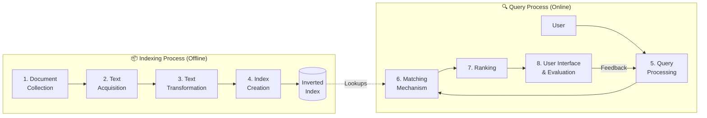

# Module 1.3 — Basic Building Blocks of an IR System

> **Syllabus Coverage:** The Indexing Process · The Query Process · Text Acquisition · Text Transformation · Index Creation · User Interaction · Ranking · Evaluation · Inverted Index

---

## 1. The Eight Building Blocks — At a Glance

An IR system is composed of systematic processes divided between the **Indexing Environment** (offline) and the **Query Environment** (online). 

---

## 2. The Indexing Process (Offline)

The indexing process optimizes retrieval speed and accuracy by transforming raw data into structured, searchable items before a user ever submits a query.

### Block 1: Document Collection (Corpus)
- The **corpus** is the complete, foundational set of documents the system operates over (web pages, PDFs, databases).
- **Rule of IR:** The system can only return what it has indexed. A document not in the corpus effectively does not exist.

### Block 2: Text Acquisition
- **Function:** Identifies and collects raw documents from distributed sources.
- **Methods:** Web crawling (bots following hyperlinks), direct API ingestion (enterprise), or OCR (scanned images).
- **Cleaning:** Removes "noise" like advertisements, navigation menus, and duplicate content to preserve index quality.

### Block 3: Text Transformation (Preprocessing)
Converts raw text into a standard set of index terms. **Symmetry is mandatory:** this exact pipeline must also be applied to the user's query later.

| Step | Description | Example |
| :--- | :--- | :--- |
| **Tokenization** | Breaking text into individual units (tokens/words). | `"IR is fast"` → `[IR, is, fast]` |
| **Normalization** | Standardizing text (lowercase, removing punctuation). | `"State-of-the-Art!"` → `state of the art` |
| **Stop-word Removal** | Eliminating high-frequency, low-semantic words to save space. | `[the, and, is, to]` → removed |
| **Stemming** | Heuristic, rule-based reduction to a root form (fast). | `"running"` → `"run"` |
| **Lemmatization** | Dictionary-based reduction to a linguistically valid root (slower). | `"better"` → `"good"` |

### Block 4: Index Creation (The Inverted Index)
Takes transformed terms and builds the **Inverted Index** — the most critical data structure in IR. Instead of mapping Documents → Words (Forward Index), it maps **Words → Documents**.

**Types of Inverted Indexes:**
1. **Record-Level:** Contains only Document IDs (DocIDs) for each word.
2. **Word-Level (Positional):** Contains DocIDs *and* the specific positions of words within the document. This is required for phrase queries (e.g., `"data mining"`).

**Worked Example:**
*Doc 1:* "data mining techniques" | *Doc 2:* "data science" | *Doc 3:* "information retrieval data"

| Dictionary Term | Document Frequency (df) | Postings List (DocID, tf) |
| :--- | :--- | :--- |
| `data` | 3 | (D1, 1), (D2, 1), (D3, 1) |
| `information` | 1 | (D3, 1) |
| `mining` | 1 | (D1, 1) |
| `retrieval` | 1 | (D3, 1) |
| `science` | 1 | (D2, 1) |
| `techniques` | 1 | (D1, 1) |

---

## 3. The Query Process (Online)

### Block 5: Query Processing
- **Formulation:** The user translates their internal "information need" into a formal search string.
- **Processing:** The system applies the *exact same* tokenization, stopping, and stemming used in Block 3.
- **Query Expansion (Optional):** The system automatically adds synonyms to improve recall (e.g., expanding "car" to include "automobile").

### Block 6: Matching Mechanism
Uses an IR model (e.g., Boolean, Vector Space Model) to compare the processed query terms against the Inverted Index to find a candidate set of matching documents.

### Block 7: Ranking & Relevance
Scores and sorts the candidate documents to present the most useful items at the top. Each document gets a **Retrieval Status Value (RSV)**.

**TF-IDF Weighting (The Core Ranking Math):**
* **TF (Term Frequency):** How often a term appears in a *specific document*. (Higher is better).
* **IDF (Inverse Document Frequency):** How rare the term is across the *entire corpus*. (Rarer is better). 
    * `IDF = log(Total Documents / Documents containing term)`
* **Formula:** `TF-IDF Score = TF * IDF`

### Block 8: User Interaction & Evaluation

#### User Interaction
Search is a dynamic, conversational process. 
- **The Berry-Picking Model:** Users learn as they search. Their information needs naturally evolve based on the snippets and documents they encounter, prompting them to continually reformulate queries.
- **Interaction Models:** - *Pull:* User explicitly types a query.
  - *Push:* System proactively suggests content (e.g., feeds).

#### Evaluation Metrics
Measuring system effectiveness against a "ground truth" using a contingency table.

| | **Retrieved by System** | **Not Retrieved** |
| :--- | :--- | :--- |
| **Relevant (Ground Truth)** | True Positive (TP) | False Negative (FN) |
| **Not Relevant (Ground Truth)** | False Positive (FP) | True Negative (TN) |

**The Three Core Formulas:**
1. **Precision (Accuracy):** Of all documents retrieved, what fraction are actually relevant? Minimizes false positives.
   * `Precision = TP / (TP + FP)`
2. **Recall (Completeness):** Of all relevant documents in existence, what fraction did we successfully retrieve? Minimizes false negatives.
   * `Recall = TP / (TP + FN)`
3. **F-Measure (F1-Score):** The harmonic mean of Precision and Recall. It provides a single balance score and heavily penalizes extreme imbalances (unlike an arithmetic mean).
   * `F1 = 2 * (Precision * Recall) / (Precision + Recall)`

> **The Trade-off:** Increasing the number of retrieved items almost always improves Recall but decreases Precision, as more irrelevant "noise" gets caught in the wider net.

---

## 🎯 Exam-Focused Summary

- **The 8 Blocks:** Memorize the offline flow (Collection → Acquisition → Transformation → Indexing) and online flow (Processing → Matching → Ranking → UI/Evaluation).
- **Index Types:** Record-level vs. Word-level (positional). Positional is required for exact phrase matching.
- **Symmetry is King:** If you stem documents with the Porter Stemmer during indexing, you *must* stem user queries with the Porter Stemmer. 
- **TF-IDF:** High score = the term is highly frequent in the document, but very rare globally.
- **Evaluation:** Precision is about *quality* (accuracy of retrieved). Recall is about *quantity* (finding all relevant items). F1 balances them.
- **Berry-Picking:** Search is not a one-and-done query; it is an evolving, iterative learning process.