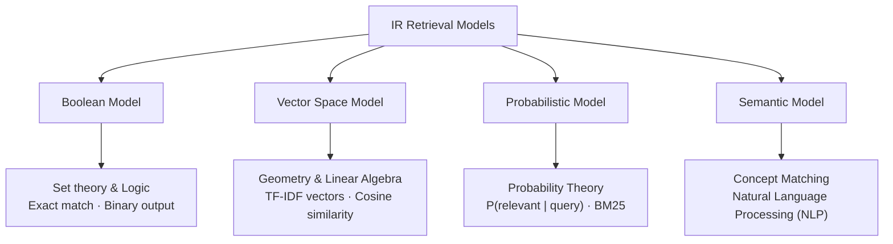
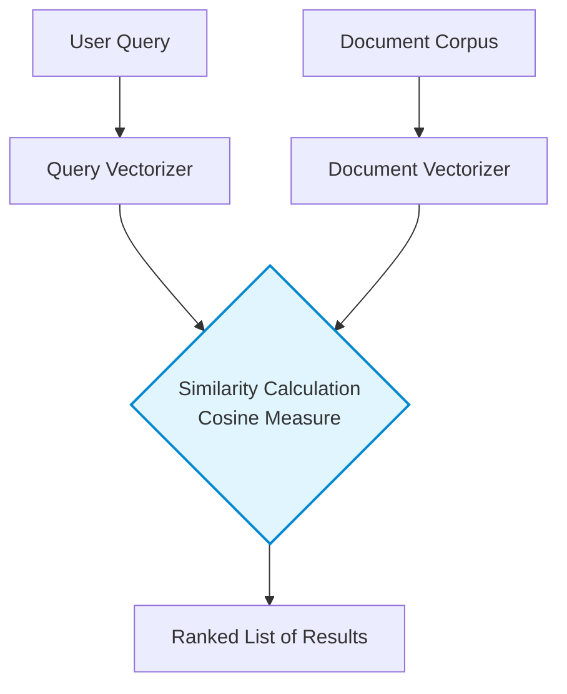

# Module 2.1 — Overview of Retrieval Models & Statistical Frameworks

> **Syllabus Coverage:** Overview of Retrieval Models · TF-IDF Weighting · Boolean Retrieval Model · Vector Space Model (VSM) · Cosine Similarity Measure

---

## 1. What is a Retrieval Model?

A **retrieval model** is a formal, mathematical representation of the process of matching a user's query against a document collection. It provides the algorithmic basis for ranking results by predicting which documents are most likely to satisfy the user's information need.

### 1.1 Categories of Models
Modern IR systems primarily utilize three classic statistical frameworks and an emerging semantic framework:

| Model | Mathematical Foundation | Output | Ranking? |
| :--- | :--- | :--- | :--- |
| **Boolean** | Set theory / Formal logic | Binary set (in / out) | ❌ No |
| **Vector Space (VSM)** | Linear algebra / Geometry | Score $\in [0, 1]$ | ✅ Yes |
| **Probabilistic** | Probability theory | Ranked score | ✅ Yes |
| **Semantic** | Neural Networks / NLP | Ranked score | ✅ Yes |

> **Scope of 2.1:** Boolean and VSM in full depth. Probabilistic / BM25 is covered in Module 2.2.

---

## 2. The Boolean Retrieval Model

The Boolean model is the simplest and earliest IR model, treating documents and queries as sets of terms.

### 2.1 Core Mechanics

- **Logic:** Queries are formulated using standard Boolean operators: `AND` (Intersection), `OR` (Union), and `NOT` (Difference).
- **Binary Relevance:** Relevance is a binary concept; a document either matches the query exactly or it does not.
- **Ranking:** In its purest form, the Boolean model has **no notion of ranking**. All retrieved documents are considered equally important, regardless of how many times the query terms appear.

### 2.2 Boolean Operators → Set Operations

| Operator | Set Operation | Meaning | Inverted Index Operation |
| :--- | :--- | :--- | :--- |
| `t1 AND t2` | $t_1 \cap t_2$ | **Both** terms must be present | Intersection of postings lists |
| `t1 OR t2` | $t_1 \cup t_2$ | **At least one** term present | Union of postings lists |
| `NOT t1` | Complement | Term must be **absent** | Complement of postings list |

### 2.3 Boolean Retrieval — Full Worked Example

**Corpus & Inverted Index:**
- `information` $\rightarrow$ {D1, D2, D5}
- `retrieval` $\rightarrow$ {D1, D3}
- `data` $\rightarrow$ {D2, D3, D4}
- `mining` $\rightarrow$ {D2}

**Query:** `(information OR retrieval) AND data`
1. `information OR retrieval` $\rightarrow$ Union = {D1, D2, D3, D5}
2. `data` $\rightarrow$ {D2, D3, D4}
3. `Intersection` of Step 1 and Step 2 $\rightarrow$ **{D2, D3}** (Final Result)

### 2.4 Advantages and Disadvantages

| Strengths ✅ | Weaknesses ❌ |
| :--- | :--- |
| Predictable results; precise user control. | **"Feast or famine" problem:** returns too many or zero matches. |
| Easy to incorporate metadata (date, author). | **No ranking:** all results treated equally. |
| Fast execution via inverted index. | **No partial matching:** miss one term = miss entire document. |

---

## 3. TF-IDF — The Term Weighting Scheme

TF-IDF (Term Frequency-Inverse Document Frequency) is a statistical weight used to evaluate the importance of a word within a document relative to a collection. It forms the backbone of the Vector Space Model.

### 3.1 Term Frequency (TF)
- **Definition:** Measures how frequently a term $i$ appears in document $j$. Higher frequency typically indicates higher relevance to that specific document.
- **Normalization:** Raw counts are often normalized (e.g., via log-normalization) to prevent favoring long documents.
  - *Log-normalized formula:* `1 + log(count)` (if count > 0). The relationship between frequency and relevance is sublinear, meaning 100 mentions is not 100x more relevant than 1 mention.

### 3.2 Inverse Document Frequency (IDF)
- **Definition:** Measures the rarity of a term across the entire collection $N$. Rare terms are more informative than common terms and are assigned higher weights.
- **Formula:** $IDF_i = \log(N/n_i)$
  *(where $n_i$ is the number of documents containing term $i$)*
- **Critical Exam Fact:** If a term appears in **all** $N$ documents, $IDF = \log(N/N) = \log(1) = 0$. The term contributes **zero weight** regardless of its frequency.

### 3.3 The TF-IDF Product
The final weight $w_{ij}$ is the product of TF and IDF. 
$$w_{ij} = TF_{ij} \times IDF_i$$
A term receives a high weight if it occurs frequently in a specific document but is rare in the rest of the collection, effectively discriminating that document from others.

---

## 4. The Vector Space Model (VSM)

Proposed by Gerard Salton, the VSM solves the Boolean model's binary limitation by providing a geometric framework where documents and queries are represented as vectors in an $n$-dimensional space.

### 4.1 Representation
- **Dimensions:** Each unique term in the vocabulary ($|V|$) represents a separate dimension.
- **Vectors:** A document $D_j$ is represented as a vector $\vec{d_j} = (w_{1j}, w_{2j}, ..., w_{nj})$, where $w$ is the TF-IDF weight of each term.
- **Query Vector:** The user's query is similarly transformed into a vector $\vec{q}$ in the same space.

### 4.2 Architectural Pattern (Query Match)

---

## 5. Cosine Similarity Measure

In the Vector Space Model, relevance is determined by the proximity of vectors in the $n$-dimensional space. Because Euclidean distance unfairly penalizes long documents, the most common measure is **Cosine Similarity**.

### 5.1 The Mathematical Formula
Cosine similarity measures the cosine of the angle $\theta$ between the document vector and the query vector:

$$\text{cosine}(\vec{d_j}, \vec{q}) = \frac{\vec{d_j} \cdot \vec{q}}{|\vec{d_j}| \times |\vec{q}|} = \frac{\sum_{i=1}^{|V|} w_{ij} \times w_{iq}}{\sqrt{\sum_{i=1}^{|V|} w_{ij}^2} \times \sqrt{\sum_{i=1}^{|V|} w_{iq}^2}}$$

### 5.2 Key Properties
- **Range:** Values range from 0 to 1.
- $\cos \theta = 1$: The vectors are identical (angle is $0^\circ$), indicating maximum similarity.
- $\cos \theta = 0$: The vectors are orthogonal (angle is $90^\circ$), indicating no terms in common.
- **Normalization:** It inherently normalizes for document length by focusing on the angle rather than the magnitude of the vectors.

### 5.3 Step-by-Step Calculation Logic
1. **Dot Product (Numerator):** Sum the products of matching term weights in the document and query.
2. **Magnitudes (Denominator):** Calculate the Euclidean length of the document and query vectors (square root of the sum of squared weights).
3. **Division:** Divide the dot product by the product of the magnitudes to get the similarity score.
4. **Ranking:** Sort documents by their scores in descending order.

---

## 6. Boolean vs. VSM — Direct Comparison

| Feature | Boolean Model | Vector Space Model (VSM) |
| :--- | :--- | :--- |
| **Document representation**| Binary (0/1 term presence) | TF-IDF weight vector |
| **Matching** | Exact logical match | Approximate geometric angle |
| **Output & Ranking** | Binary set (no ranking) | Ranked list, scores $\in [0, 1]$ |
| **Partial matches** | ❌ All-or-nothing | ✅ Partial overlap $\rightarrow$ lower score |
| **Term weighting** | ❌ All terms equal | ✅ TF-IDF weights |

---

## 🎯 Exam-Focused Summary

- A **retrieval model** defines how documents/queries are represented and scored.
- **Boolean Model:** Based on set theory. Returns binary exact matches. Plagued by the **feast-or-famine problem**.
- **TF-IDF:** High score = term is frequent in the specific document (TF), but rare across the entire corpus (IDF). If a term is in *all* documents, its IDF is 0.
- **Vector Space Model (VSM):** Represents documents and queries as high-dimensional TF-IDF vectors.
- **Cosine Similarity:** Measures the angle between vectors to determine relevance, which naturally normalizes for document length. $1.0$ is a perfect match, $0.0$ means orthogonal (no shared terms).
- **Limitation:** Both models assume **term independence** — they ignore word order, semantics, and synonyms entirely.